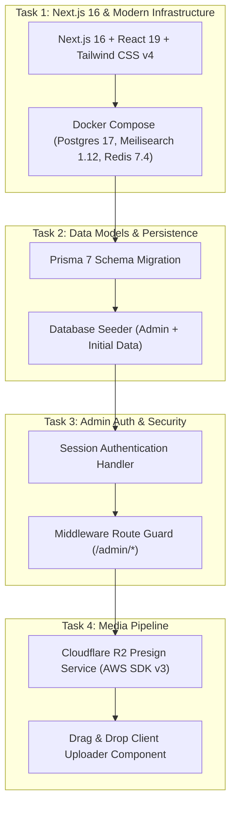

# Phase 1 Plan: Foundation, Data Models & Asset Pipeline (Next.js 16 + Modern Stack)

## Phase Goal
Bootstrap the production repository with Next.js 16 (App Router, Turbopack, React 19), containerized modern services (PostgreSQL 17, Meilisearch 1.12, Redis 7.4), comprehensive Prisma 7 relational database schema, admin RBAC authentication with Next.js middleware protection, and Cloudflare R2 presigned upload pipeline.

---

## Architecture & Work Breakdown

---

## Detailed Tasks

### Task 1: Scaffolding, Tooling & Modern Local Infrastructure
- **Objective:** Initialize the Next.js 16 application with TypeScript strict mode, React 19, Tailwind CSS v4, Lucide icons, and containerized latest database services.
- **Files to Create/Modify:**
  - `package.json` (Next.js 16, React 19, Tailwind CSS v4, Lucide React, Zod)
  - `tsconfig.json` (with `"strict": true`)
  - `docker-compose.yml`
  - `.env.example` & `.env`
  - `src/lib/utils.ts`
- **Docker Services:**
  - `postgres`: `postgres:17-alpine`, port `5432:5432`
  - `meilisearch`: `getmeili/meilisearch:v1.12`, port `7700:7700`
  - `redis`: `redis:7.4-alpine`, port `6379:6379`
- **Verification:**
  - `docker compose up -d` brings up all 3 containers.
  - Connection tests succeed against DB and Redis.

---

### Task 2: Prisma ORM Schema & Database Seeding
- **Objective:** Define and migrate the full relational schema matching all core entities in the PRD, and provide an initial seeder.
- **Files to Create/Modify:**
  - `prisma/schema.prisma`
  - `prisma/seed.ts`
  - `src/lib/prisma.ts` (Global singleton client)
- **Entities Covered:**
  - `User` (email, passwordHash, role: `OWNER` | `ADMIN` | `STAFF`)
  - `Product` (title, handle, description, status, seoTitle, seoDescription)
  - `ProductOption` & `ProductOptionValue`
  - `ProductVariant` (sku, barcode, priceCents, compareAtPriceCents, costCents, inventoryQuantity, reservedQuantity, weightGrams)
  - `ProductMedia` (url, altText, position, mimeType, sizeBytes)
  - `Collection` & `CollectionProduct` (type: `MANUAL` | `SMART`, rules JsonB)
  - `Order`, `OrderItem`, `Fulfillment`, `Refund`, `OrderEvent`
  - `InventoryReservation` (variantId, quantity, expiresAt, status: `PENDING` | `COMMITTED` | `EXPIRED`)
  - `ProcessedWebhookEvent` (eventId, source, processedAt)
- **Verification:**
  - `npx prisma migrate dev --name init` completes.
  - `npx prisma db seed` seeds an `OWNER` user (`admin@store.local`) and sample product.

---

### Task 3: Admin RBAC Authentication & Route Guard
- **Objective:** Provide secure session-based authentication for merchant staff and lock `/admin/*` routes.
- **Files to Create/Modify:**
  - `src/lib/auth/session.ts` (Cookie-based encrypted session or signed token)
  - `src/lib/auth/password.ts` (Argon2 / bcrypt hashing)
  - `src/app/admin/login/page.tsx` (Sign-in form)
  - `src/app/admin/login/actions.ts` (Next.js 16 Server Action for authentication)
  - `src/middleware.ts` (Edge middleware verifying session cookies)
  - `src/app/admin/layout.tsx` (Protected Admin shell)
- **Verification:**
  - Navigating to `/admin` without credentials redirects to `/admin/login`.
  - Logging in with seeded credentials sets session cookie and grants access to `/admin`.

---

### Task 4: Cloudflare R2 Presigned Upload Service & Uploader
- **Objective:** Allow direct browser-to-R2 media uploads with presigned PUT URLs, strictly validating MIME types and sizes.
- **Files to Create/Modify:**
  - `src/lib/storage/r2.ts` (S3 client configured with Cloudflare R2 credentials)
  - `src/app/api/admin/media/presign/route.ts` (Presigning route)
  - `src/components/admin/media-uploader.tsx` (UI with drag-and-drop & progress bar)
- **Constraints:**
  - Allowed MIME: `image/jpeg`, `image/png`, `image/webp`, `image/gif`, `video/mp4`
  - Max image size: 20MB; Max video size: 100MB
- **Verification:**
  - Request to `/api/admin/media/presign` returns valid signed PUT URL.
  - File upload via `PUT` returns `200 OK` and persists in R2.

---

## Phase 1 Acceptance Gates
1. [ ] Next.js 16 app builds cleanly with zero TypeScript errors (`npm run build`).
2. [ ] `docker compose ps` shows `postgres`, `meilisearch`, and `redis` healthy.
3. [ ] Prisma migration and seeding run without warning or error.
4. [ ] `/admin` route is secured via middleware.
5. [ ] Presigned R2 upload generates valid URLs and accepts asset uploads.
