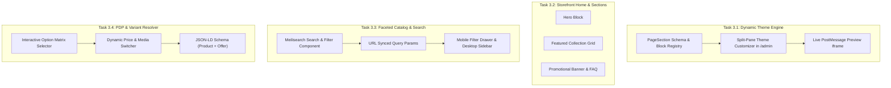

# Phase 3 Plan: Storefront & Dynamic Theme Customizer

## Phase Goal
Deliver a sub-100ms TTFB customer-facing storefront powered by Next.js ISR, an interactive multi-option PDP variant resolver with JSON-LD SEO, instant Meilisearch faceted collection pages, and a visual split-pane homepage theme customizer in `/admin`.

---

## Architecture & Work Breakdown

---

## Detailed Tasks

### Task 3.1: Dynamic Theme Engine & Visual Customizer
- **Objective:** Create a modular, JSON-backed section rendering architecture with a Shopify-like visual customizer.
- **Files to Create/Modify:**
  - `src/lib/theme/sections-registry.ts` (Registry mapping section types to React components)
  - `src/components/sections/hero-section.tsx`
  - `src/components/sections/featured-collection-section.tsx`
  - `src/components/sections/promo-banner-section.tsx`
  - `src/app/admin/theme-customizer/page.tsx` (Split-pane editor with drag-and-drop section reordering)
  - `src/app/admin/theme-customizer/preview/page.tsx` (Isolated preview iframe communicating via `window.postMessage`)
  - `src/app/admin/theme-customizer/actions.ts` (Save section definitions to `PageSection` table)
- **Verification:**
  - Adding, reordering, and modifying section properties in customizer renders live changes in preview and persists on save.

### Task 3.2: Storefront Homepage & Global Shell
- **Objective:** Deliver the customer storefront shell with high-performance responsive layout.
- **Files to Create/Modify:**
  - `src/app/(storefront)/layout.tsx` (Storefront header, announcement bar, navigation mega-menu, footer)
  - `src/app/(storefront)/page.tsx` (Server Component fetching cached `PageSection` blocks with `revalidateTag('store:sections')`)
  - `src/components/storefront/header.tsx`
  - `src/components/storefront/predictive-search-modal.tsx` (Instant search dialog with thumbnail previews)
- **Verification:**
  - Storefront homepage achieves < 100ms TTFB on warm Next.js cache.

### Task 3.3: Faceted Collection & Search Pages (`/collections/[handle]` & `/search`)
- **Objective:** Instant collection browsing with faceted attribute filtering and sorting synced to the URL.
- **Files to Create/Modify:**
  - `src/app/(storefront)/collections/[handle]/page.tsx`
  - `src/app/(storefront)/search/page.tsx`
  - `src/components/storefront/facet-filters.tsx` (Price range slider, color swatches, size chips, in-stock toggle)
  - `src/components/storefront/product-grid.tsx`
  - `src/components/storefront/product-card.tsx` (Optimized images with Next.js Image, quick add hover)
- **URL Schema:**
  - `/collections/summer?price=2000-8000&color=blue&size=L&sort=price_asc&page=1`
- **Verification:**
  - Toggling filters updates URL and renders filtered Meilisearch results in < 50ms without full page reload.

### Task 3.4: Product Detail Page (`/products/[handle]`) & Variant Resolver
- **Objective:** Production-grade PDP resolving complex variant combinations, live inventory status, and rich SEO structured data.
- **Files to Create/Modify:**
  - `src/app/(storefront)/products/[handle]/page.tsx`
  - `src/components/storefront/pdp-variant-selector.tsx` (Interactive buttons with disabled states for out-of-stock combinations)
  - `src/components/storefront/pdp-media-gallery.tsx` (Thumbnail carousel with zoom and variant-mapped image switching)
  - `src/components/storefront/pdp-json-ld.tsx` (`Product`, `Offer`, `AggregateRating` schema.org markup)
- **Logic:**
  - Resolves selected options:
    $$\text{SelectedVariant} = f(\text{selectedSize}, \text{selectedColor}, \dots)$$
  - Dynamically updates URL param `?variant=123` via shallow routing.
  - Updates display price, compare-at price savings badge, and "Add to Cart" button state (In Stock vs Sold Out).
- **Verification:**
  - Switching variants immediately swaps images, price, and stock status; Google Rich Results Test passes JSON-LD validation.

---

## Phase 3 Acceptance Gates
1. [ ] Theme customizer can add, reorder, toggle, and edit homepage sections with live iframe preview.
2. [ ] Storefront homepage renders from database sections with sub-100ms TTFB.
3. [ ] Collection pages support multi-facet filtering (price, tags, options) with full URL synchronization.
4. [ ] PDP correctly resolves variant combinations, swaps images, displays live availability, and renders JSON-LD.
