# Phase 4 Plan: Cart, Inventory Concurrency & Stripe Checkout

## Phase Goal
Engineer a resilient checkout pipeline featuring an optimistic Redis/DB cart, 0% oversell inventory reservation holds using PostgreSQL row-level locks, and an idempotent Stripe Checkout flow with webhook deduplication.

---

## Architecture & Work Breakdown

```mermaid
flowchart TD
    subgraph S1["Task 4.1: Cart Engine"]
        A1["Slide-Over Cart Drawer UI"] --> A2["Redis Session Cart (Guest)"]
        A2 --> A3["Cart Merge on Customer Login"]
    end
    subgraph S2["Task 4.2: Inventory Reservation"]
        B1["Checkout Initiation"] --> B2["PostgreSQL SELECT FOR UPDATE Lock"]
        B2 --> B3["Create InventoryReservation (15-min TTL)"]
        B3 --> B4["Background Sweeper for Expired Holds"]
    end
    subgraph S3["Task 4.3: Stripe Checkout"]
        C1["Stripe PaymentIntent Creation"] --> C2["Embedded PaymentElement Form"]
        C2 --> C3["Client Confirmation"]
    end
    subgraph S4["Task 4.4: Webhook Idempotency"]
        D1["Stripe Webhook (payment_intent.succeeded)"] --> D2["ProcessedWebhookEvent Check"]
        D2 --> D3["Atomic Order & OrderItem Ledger Write"]
        D3 --> D4["Commit Inventory & Clear Hold"]
    end
```



---

## Detailed Tasks

### Task 4.1: Slide-Over Cart Drawer & Hybrid Persistence
- **Objective:** Provide a fast, responsive cart experience supporting guest sessions and seamless authenticated syncing.
- **Files to Create/Modify:**
  - `src/components/cart/cart-drawer.tsx` (Slide-over drawer with item thumbnails, quantity stepper, subtotal, checkout button)
  - `src/lib/cart/cart-service.ts` (Cart CRUD operations)
  - `src/app/api/cart/route.ts` & `src/app/api/cart/items/route.ts`
  - `src/lib/cart/session.ts` (Encrypted cookie referencing Redis key `cart:{sessionId}`)
- **Merge Behavior:**
  - When an unauthenticated customer with items in Redis logs in, existing items merge into the customer's database `Cart` without dropping quantities.
- **Verification:**
  - Adding items updates cart drawer optimistically in < 50ms; cart persists across browser refreshes and merges on login.

---

### Task 4.2: Concurrency-Safe Inventory Hold Engine
- **Objective:** Eliminate flash-sale overselling with atomic stock reservation holds.
- **Files to Create/Modify:**
  - `src/lib/inventory/reservation-service.ts` (Atomic hold creation, extension, release, and commit)
  - `src/lib/jobs/inventory-sweep.ts` (Scheduled task releasing holds where `expiresAt < NOW()`)
- **Core Reservation SQL Algorithm:**
  ```sql
  -- Executed inside a SERIALIZABLE or READ COMMITTED transaction
  SELECT id, inventory_quantity, reserved_quantity 
  FROM "ProductVariant" 
  WHERE id = $variantId 
  FOR UPDATE;

  -- Ensure available stock >= requested
  IF (inventory_quantity - reserved_quantity) >= $requestedQty THEN
    INSERT INTO "InventoryReservation" (variant_id, checkout_id, quantity, expires_at, status)
    VALUES ($variantId, $checkoutId, $requestedQty, NOW() + INTERVAL '15 minutes', 'PENDING');
    
    UPDATE "ProductVariant" 
    SET reserved_quantity = reserved_quantity + $requestedQty 
    WHERE id = $variantId;
  ELSE
    RAISE EXCEPTION 'OUT_OF_STOCK';
  END IF;
  ```
- **Verification:**
  - Concurrency test simulating 20 simultaneous checkout requests for an item with only 5 units in stock: exactly 5 succeed, 15 receive structured out-of-stock errors; 0 oversold.

---

### Task 4.3: Stripe Checkout & Payment Processing
- **Objective:** Provide secure, multi-currency checkout via Stripe Payment Element.
- **Files to Create/Modify:**
  - `src/app/(storefront)/checkout/page.tsx` (Customer info, shipping address, rate selection, PaymentElement)
  - `src/app/api/checkout/create-intent/route.ts` (Validates cart, reserves inventory, creates Stripe `PaymentIntent`)
  - `src/lib/stripe/client.ts` & `src/lib/stripe/server.ts`
  - `src/components/checkout/stripe-payment-form.tsx`
- **Verification:**
  - Initiating checkout creates `PaymentIntent` matching exact cart subtotal + shipping in integer cents; reservation hold is recorded with matching `client_secret`.

---

### Task 4.4: Idempotent Webhook Finalization & Order Ledger
- **Objective:** Finalize purchases reliably upon receiving Stripe events, guaranteeing zero duplicate orders.
- **Files to Create/Modify:**
  - `src/app/api/webhooks/stripe/route.ts` (Raw body signature verification via `stripe.webhooks.constructEvent`)
  - `src/lib/orders/order-finalizer.ts` (Atomic database transaction)
- **Finalization Transaction Steps:**
  1. Insert event ID into `ProcessedWebhookEvent` (`ON CONFLICT DO NOTHING`). If duplicate, return `200 OK` immediately.
  2. Create `Order` record with unique `paymentIntentId`, order number (e.g., `#1001`), customer association, and billing/shipping addresses.
  3. Create `OrderItem` snapshots (title, sku, unit price at purchase).
  4. Transition `InventoryReservation` from `PENDING` to `COMMITTED`.
  5. Atomically decrement `inventoryQuantity` and `reservedQuantity`:
     $$\text{inventoryQuantity} \leftarrow \text{inventoryQuantity} - \text{purchasedQty}$$
     $$\text{reservedQuantity} \leftarrow \text{reservedQuantity} - \text{purchasedQty}$$
  6. Emit `OrderEvent` (`ORDER_PLACED`, `PAYMENT_RECEIVED`).
  7. Clear customer cart.
- **Verification:**
  - Simulating duplicate webhook deliveries with the same `evt_...` ID results in exactly one database order created.

---

## Phase 4 Acceptance Gates
1. [ ] Cart drawer opens instantly, supports guest and authenticated carts, and updates optimistically.
2. [ ] Inventory reservation hold prevents concurrent overselling under simulated load.
3. [ ] Expired reservations are automatically released by the sweeper job.
4. [ ] Stripe PaymentElement collects payment and webhook converts intent into an immutable `Order`.
5. [ ] Webhook handler demonstrates 100% idempotency against replayed events.
