# Phase 5 Plan: Post-Purchase Operations, Discounts & Analytics

## Phase Goal
Complete the merchant operational lifecycle: order fulfillment and refunds with full audit trails, customer self-service order portal, a multi-type discount and coupon engine, and high-level sales analytics with time-series charts.

---

## Architecture & Work Breakdown

```mermaid
flowchart TD
    subgraph S1["Task 5.1: Order Management & Fulfillment"]
        A1["Filterable Admin Orders Table"] --> A2["Order Detail Ledger & Audit Timeline"]
        A2 --> A3["Fulfillment Modal (Tracking & Carrier)"]
        A2 --> A4["Stripe Refund Modal (Restock Option)"]
    end
    subgraph S2["Task 5.2: Customer Account Portal"]
        B1["Customer Login & Magic Links"] --> B2["Order History & Status Timeline"]
        B2 --> B3["Address Book Management"]
    end
    subgraph S3["Task 5.3: Promotions & Discounts"]
        C1["Discount Rule Builder in /admin"] --> C2["Checkout Code Validation Engine"]
        C2 --> C3["Usage Limits & Date Window Tracking"]
    end
    subgraph S4["Task 5.4: Merchant Analytics"]
        D1["Sales & Revenue Time-Series Charts"] --> D2["AOV & Conversion Rate Metrics"]
        D2 --> D3["Top Products & Variants Leaderboard"]
    end
```

---

## Detailed Tasks

### Task 5.1: Admin Order Processing, Fulfillment & Refunds
- **Objective:** Equip store merchants with Shopify-grade order fulfillment and refund tools.
- **Files to Create/Modify:**
  - `src/app/admin/orders/page.tsx` (Table with tabs: All, Unfulfilled, Unpaid, Completed, Cancelled)
  - `src/app/admin/orders/[id]/page.tsx` (Order detail view with line item ledger and `OrderEvent` timeline)
  - `src/components/admin/fulfillment-modal.tsx` (Carrier selector e.g. USPS, FedEx, DHL, UPS + tracking number input)
  - `src/components/admin/refund-modal.tsx` (Select line items/quantities, custom refund amount, restock checkbox, Stripe refund trigger)
  - `src/app/admin/orders/actions.ts`
- **Verification:**
  - Fulfilling an order records a `Fulfillment` record, logs an `OrderEvent`, and updates order status to `FULFILLED`.
  - Issuing a refund invokes `stripe.refunds.create`, records a `Refund` model, and optionally returns inventory.

---

### Task 5.2: Customer Account Portal (`/account`)
- **Objective:** Give buyers self-service access to past purchases and tracking numbers.
- **Files to Create/Modify:**
  - `src/app/(storefront)/account/page.tsx` (Account overview)
  - `src/app/(storefront)/account/orders/page.tsx` & `src/app/(storefront)/account/orders/[id]/page.tsx`
  - `src/app/(storefront)/account/addresses/page.tsx` (Saved addresses CRUD)
  - `src/app/(storefront)/account/login/page.tsx`
- **Verification:**
  - Logged-in customer can view their past orders, inspect fulfillment status with clickable tracking links, and update default shipping address.

---

### Task 5.3: Dynamic Promotions & Coupon Engine
- **Objective:** Implement flexible promotional discounting compatible with checkout calculations.
- **Files to Create/Modify:**
  - `src/app/admin/discounts/page.tsx` (Discount codes list with status, usage counts)
  - `src/app/admin/discounts/new/page.tsx` (Discount form)
  - `src/lib/discounts/calculator.ts` (Evaluation engine)
  - `src/app/api/discounts/validate/route.ts`
- **Discount Types Supported:**
  - `PERCENTAGE` (e.g., 20% off entire order or specific collection)
  - `FIXED_AMOUNT` (e.g., $10 off orders over $50)
  - `FREE_SHIPPING`
  - `BUY_X_GET_Y`
- **Constraints Checked:** Minimum purchase amount, maximum global uses, per-customer usage limits, active date range (`startsAt`, `endsAt`).
- **Verification:**
  - Valid coupon applies discount to cart subtotal; invalid, expired, or over-limit codes return clear validation errors.

---

### Task 5.4: Merchant Analytics & Reporting Dashboard
- **Objective:** Provide actionable commercial intelligence with interactive charts.
- **Files to Create/Modify:**
  - `src/app/admin/page.tsx` (Executive analytics dashboard)
  - `src/components/admin/analytics/revenue-chart.tsx` (Time-series chart for Gross/Net sales using Recharts)
  - `src/components/admin/analytics/kpi-card.tsx` (Total Revenue, Total Orders, Average Order Value, Return Customer Rate)
  - `src/components/admin/analytics/top-products-table.tsx` (Leaderboard sorted by units sold or revenue generated)
  - `src/lib/analytics/queries.ts` (Aggregated Prisma SQL queries with date range filters: Today, Last 7 Days, Last 30 Days, Year to Date)
- **Verification:**
  - Analytics cards and charts load aggregated data correctly reflecting committed orders across selected date ranges.

---

## Phase 5 Acceptance Gates
1. [ ] Admin can fulfill orders with carrier tracking and issue partial/full Stripe refunds.
2. [ ] Customer can log into `/account`, view order history, and track shipments.
3. [ ] Discount engine validates and applies percentage, fixed, and free-shipping codes with usage caps.
4. [ ] Admin dashboard displays accurate revenue, AOV, order volume, and top-seller leaderboard.
