# Phase 6 Plan: UI/UX & Motion Redesign (Modern Sovereign Commerce)

## Phase Goal
Transform the Swarajya platform into an editorial-grade, ultra-responsive commerce experience by implementing the **UI-SPEC.md** design contract, synthesizing **UI/UX Pro Max** accessibility & layout standards with **UI-Motion** fluid interaction patterns.

---

## Architecture & Work Breakdown

```mermaid
flowchart TD
    subgraph T1["Task 6.1: Design Tokens & CSS Motion Engine"]
        A1["globals.css Keyframes (Silk, Spring, Shimmer)"] --> A2["Glassmorphic & Depth Utilities"]
    end
    subgraph T2["Task 6.2: Header & Predictive Search Experience"]
        B1["Header Glass Blur & Cart Pulse Pill"] --> B2["Cmd+K Search Modal with Tag Chips"]
    end
    subgraph T3["Task 6.3: Editorial Product Card & Faceted Catalog"]
        C1["Aspect 4:5 Card with Hover Image Lift"] --> C2["Quick Add-to-Bag Slide-up"]
        C2 --> C3["Refined Facet Filters & Stock Pills"]
    end
    subgraph T4["Task 6.4: High-End PDP & Slide-Over Cart Drawer"]
        D1["Staggered Image Gallery with Zoom"] --> D2["Tactile Variant Pills & Scarcity Notice"]
        D2 --> D3["Cart Drawer: Free Shipping Progress Meter"]
    end
    subgraph T5["Task 6.5: Customer Portal & Merchant Admin Overhaul"]
        E1["Visual 4-Stage Shipment Stepper (/account)"] --> E2["Polished Merchant Analytics & KPI Sparklines (/admin)"]
    end
```

---

## Detailed Tasks

### Task 6.1: Global Design Tokens & CSS Motion Engine
- **Files to Modify:**
  - `src/app/globals.css`
  - `src/app/layout.tsx`
- **Deliverables:**
  - Inject CSS keyframe animations for `silk-enter`, `spring-pop`, `shimmer-sweep`, and `pulse-subtle`.
  - Add utility classes for glassmorphic backdrops (`backdrop-blur-xl bg-zinc-950/80 border-zinc-800/70`).
  - Standardize focus ring styles for full keyboard accessibility (`focus-visible:ring-2 focus-visible:ring-indigo-500`).

---

### Task 6.2: Storefront Header & Predictive Search Experience
- **Files to Modify:**
  - `src/components/storefront/header.tsx`
  - `src/components/storefront/predictive-search-modal.tsx`
- **Deliverables:**
  - Implement blurred sticky header with smooth logo hover micro-interaction.
  - Add animated cart badge that bounces slightly on quantity change.
  - Wire global `⌘K` / `Ctrl+K` keyboard shortcut to open predictive search modal.
  - Include quick search tag chips (`Outerwear`, `Titanium`, `Merino`, `Leather`) for instant filtering.

---

### Task 6.3: Editorial Product Cards & Faceted Catalog Browsing
- **Files to Modify:**
  - `src/components/storefront/product-card.tsx`
  - `src/components/storefront/facet-filters.tsx`
  - `src/app/collections/[handle]/page.tsx`
- **Deliverables:**
  - Redesign product card to editorial `aspect-[4/5]` with subtle border lift (`hover:-translate-y-1 hover:border-zinc-700`).
  - Live inventory badge: Green glowing pulse dot for in-stock, amber for low-stock items.
  - Quick action: "Add to Bag" button slides up smoothly on desktop card hover.
  - Facet filters: Clean toggle pills with active counters and instant URL sync.

---

### Task 6.4: High-End Product Detail Page (PDP) & Slide-Over Cart Drawer
- **Files to Modify:**
  - `src/components/storefront/pdp-client.tsx`
  - `src/components/cart/cart-drawer.tsx`
- **Deliverables:**
  - PDP: Multi-angle thumbnail selector with active indicator and smooth image transition.
  - Variant selectors: High-contrast tactile pills with instant price recalculation.
  - Cart Drawer: Silk right-to-left slide entrance with darkened backdrop.
  - Free Shipping Progress Meter: Dynamically calculates remaining amount towards free shipping (e.g. `$100.00` target).
  - Quantity micro-steppers (`-` / `+`) with tactile click feedback (`active:scale-95`).

---

### Task 6.5: Customer Portal & Merchant Admin Polish
- **Files to Modify:**
  - `src/app/account/page.tsx`
  - `src/app/account/orders/[id]/page.tsx`
  - `src/app/admin/page.tsx`
  - `src/components/admin/analytics/revenue-chart.tsx`
- **Deliverables:**
  - Customer order tracking: 4-stage visual progress stepper (`Placed` &rarr; `Confirmed` &rarr; `Dispatched` &rarr; `Delivered`).
  - Admin Dashboard: Modern KPI cards with colored trend indicators and polished SVG sales velocity area chart.

---

## Phase 6 Acceptance Gates
1. [ ] All interactive buttons meet minimum 44x44px touch targets with visible focus rings.
2. [ ] Cart drawer opens smoothly with Silk transition and displays free shipping threshold meter.
3. [ ] Product cards feature editorial aspect ratio, hover lift, live stock status, and quick add action.
4. [ ] Global `⌘K` / `Ctrl+K` opens predictive search modal smoothly.
5. [ ] Production build (`npm run build`) passes with zero TypeScript warnings or errors.
