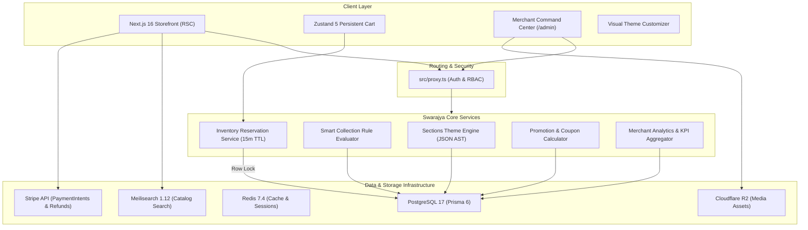

# Swarajya (स्वराज्य)

> **Sovereign, High-Performance, Self-Hosted Commerce Engine**  
> *Zero platform tax. 0% oversell. Sub-100ms TTFB. Full merchant autonomy.*

---

## Overview

**Swarajya (स्वराज्य)** is a single-merchant, self-hosted e-commerce platform built as a modern, high-performance alternative to Shopify. It eliminates third-party subscription locks, platform transaction fees, and vendor constraints while providing enterprise-grade architecture.

### Key Pillars
- **Sovereign Ownership:** Own 100% of your customer data, transactional ledger, and codebase.
- **0% Oversell Guarantee:** ACID-compliant row-level locks (`SELECT ... FOR UPDATE`) with 15-minute reservation TTLs guarantee zero accidental overselling during high-concurrency drop events.
- **Sub-100ms TTFB Storefront:** Powered by Next.js 16 with Turbopack, React 19 Server Components, and Tailwind CSS v4.
- **Live Theme Customizer:** Split-pane visual customizer with bidirectionally synced `postMessage` iframe rendering modular JSON sections (`Hero`, `FeaturedCollection`, `PromotionalBanner`, `FAQ`).
- **Real-Time Catalog Search:** Meilisearch 1.12 with typo tolerance and instant search modal.
- **Idempotent Stripe Checkout:** Webhook deduplication via `ProcessedWebhookEvent` ensuring zero double-charging or missed fulfillment.
- **Merchant Intelligence:** Built-in financial analytics, sales velocity tracking, AOV computation, and fulfillment tracking.

---

## System Architecture



---

## Tech Stack

| Layer | Technology | Version | Purpose |
| :--- | :--- | :--- | :--- |
| **Framework** | Next.js App Router | `16.4.6` | Server Components, Server Actions, Turbopack |
| **UI Library** | React | `19.3.1` | Concurrent rendering, `useActionState`, hooks |
| **Styling** | Tailwind CSS | `v4.0.0` | Zero-runtime modern styling |
| **Database** | PostgreSQL | `17` | Relational order ledger, inventory transactions |
| **ORM** | Prisma | `6.4.1` | Type-safe schema & migrations |
| **Search Engine**| Meilisearch | `1.12` | Sub-50ms typo-tolerant product discovery |
| **In-Memory** | Redis | `7.4` | Caching & ephemeral hold coordination |
| **Payments** | Stripe SDK | `v23.2.0` | Idempotent PaymentIntents & Stripe Refunds |
| **Storage** | Cloudflare R2 | S3 API | Direct-to-bucket presigned media uploads |
| **State** | Zustand | `v5.0.3` | Slide-over cart persistence & synchronization |

---

## Repository Structure

```
├── .planning/               # GSD Roadmap, state, and phase plans
├── docker-compose.yml       # Postgres 17, Meilisearch 1.12, Redis 7.4
├── prisma/
│   ├── schema.prisma        # Complete relational commerce schema (13 models)
│   └── seed.ts              # Default admin & sample catalog seeder
├── src/
│   ├── app/
│   │   ├── (storefront)/    # Storefront pages (PDP, Collections, Cart, Checkout)
│   │   ├── account/         # Customer account portal, order tracking & addresses
│   │   ├── admin/           # Products, Collections, Orders, Discounts, Analytics
│   │   ├── api/             # Search, Webhooks, Media Presigning, Cron Sweeper
│   │   └── proxy.ts         # Next.js 16 route proxy & admin authentication
│   ├── components/
│   │   ├── admin/           # Fulfillment & refund modals, product/collection forms
│   │   ├── cart/            # Persistent slide-over cart drawer
│   │   ├── sections/        # Dynamic theme section blocks (Hero, Banner, FAQ)
│   │   └── storefront/      # Header, Facet filters, Predictive search, PDP
│   └── lib/
│       ├── analytics/       # Aggregated sales velocity & top products queries
│       ├── auth/            # Admin & Customer session handling (jose JWT)
│       ├── cart/            # Zustand cart store & synchronization
│       ├── collections/     # Smart collections AST evaluator
│       ├── discounts/       # Coupon & discount calculation engine
│       ├── inventory/       # PostgreSQL SELECT FOR UPDATE reservation engine
│       ├── jobs/            # Background inventory sweeper worker
│       ├── search/          # Meilisearch client & cache tag synchronizer
│       └── storage/         # Cloudflare R2 S3 presigned URL service
```

---

## Getting Started

### 1. Prerequisites
- Node.js `20.x` or `22.x`
- Docker & Docker Compose
- Git

### 2. Clone and Install
```bash
git clone https://github.com/gajukharche/swarajya.git
cd swarajya
npm install
```

### 3. Spin Up Local Infrastructure
Launch PostgreSQL 17, Meilisearch 1.12, and Redis 7.4:
```bash
docker-compose up -d
```

### 4. Configure Environment
Copy `.env.example` to `.env` and configure your credentials:
```bash
cp .env.example .env
```

### 5. Push Schema & Seed Initial Admin
```bash
npm run db:push
npm run db:seed
```

Default credentials seeded:
- **Admin Email:** `admin@store.local`
- **Admin Password:** `adminpassword123`

### 6. Run Development Server
```bash
npm run dev
```
Open [http://localhost:3000](http://localhost:3000) for the storefront, and [http://localhost:3000/admin](http://localhost:3000/admin) for the Merchant Command Center.

---

## Production Build Verification
```bash
npm run build
```
All 32 dynamic and static routes compile cleanly under Next.js 16 Turbopack with zero warnings.

---

## License
MIT &copy; 2026 [Gajukharche](https://github.com/gajukharche).
